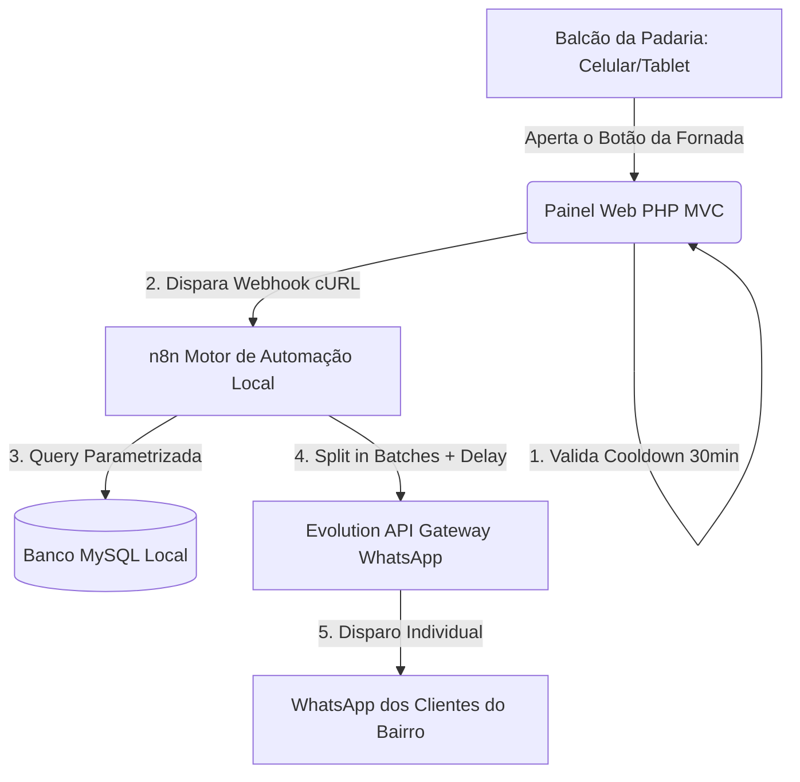
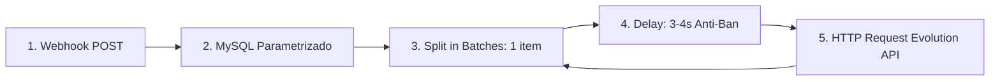

# 🥖 Pãozin — Documentação Oficial do Projeto
> **Sistema inteligente para aviso de pão quentinho, mapa de busca e avaliação de padarias locais.**

Este documento consolida a visão de negócios, a modelagem de dados, a arquitetura de software, as estratégias de viabilidade e as diretrizes de engenharia do **Pãozin**. O projeto foi concebido para o ecossistema de *foodtech hiperlocal*, conectando o comércio de bairro ao consumidor no minuto exato em que a fornada de pão francês fica pronta.

---

## 🎯 1. Proposta de Valor e Modelo de Negócios

O Pãozin resolve a assincronia entre o horário de produção da padaria e o momento de compra do cliente.

* **Para o Consumidor:**
  * Notificação instantânea via WhatsApp no minuto em que o pão sai do forno ("Pão Quentinho").
  * Mapa interativo com raio de proximidade, preço do quilo atualizado e ranking de crocância/sabor ("Nota do Pão").
  * Experiência fluida sem necessidade de instalar aplicativos pesados (Mobile Web + WhatsApp).

* **Para a Padaria:**
  * Redução drástica de desperdício de pão frio e sobras ao final do turno.
  * Pico imediato de fluxo de clientes na loja física durante a janela ideal da fornada (primeiros 20 minutos).
  * Canal direto e automatizado de fidelização no bairro com barreira zero de operação.

* **Estratégia de Preço e Monetização:**
  * **Assinatura Recorrente Fixa:** R$ 20,00/mês cobrados exclusivamente do estabelecimento parceiro.
  * **Barreira de Entrada Quase Nula:** Preço inferior a um pacote de café de mercado, facilitando a decisão imediata do comerciante.
  * **Escala por Volume:** Foco em rápida densidade territorial (bairros inteiros conectados).
  * **Cobrança Automatizada:** Recorrência via Pix ou Cartão (gateways como Asaas ou Mercado Pago).
  * **WhatsApp Centralizado vs. Canais de Alto Volume:**
    * *Fase Inicial / Volume Moderado:* Chip único oficial do Pãozin dispara as mensagens com fila humanizada.
    * *Evolução para Alto Volume:* Suporte híbrido a **Canais do WhatsApp (WhatsApp Channels)** ou grupos silenciosos de transmissão por bairro, eliminando o risco de atraso na entrega quando a lista de inscritos de uma padaria ultrapassar 150 contatos.

---

## 📊 2. Viabilidade Financeira e Análise de Escala

### 🏠 Infraestrutura de Inicialização (Custo Zero)
Para validar o MVP sem desembolso inicial, o projeto roda em um servidor doméstico (*Homelab*), exposto com segurança para a web via **Cloudflare Tunnels** (dispensando IP fixo e abertura de portas no roteador).

| Quantidade de Padarias | Receita Bruta Mensal | Custo Operacional (Homelab) | Margem / Lucro Líquido | Status do Negócio |
| :--- | :--- | :--- | :--- | :--- |
| **1 padaria** | R$ 20,00 | R$ 0,00 | **+ R$ 20,00** | Break-Even Atingido (Lucro imediato) |
| **5 padarias** | R$ 100,00 | R$ 0,00 | **+ R$ 100,00** | Validação local do bairro |
| **15 padarias** | R$ 300,00 | R$ 0,00 | **+ R$ 300,00** | Densidade territorial consolidada |
| **30 padarias** | R$ 600,00 | R$ 50,00* | **+ R$ 550,00** | Migração opcional para VPS (*se tráfego exigir) |

> 💡 **Nota:** A lucratividade desde a 1ª padaria gera caixa contínuo para financiar upgrades graduais de infraestrutura conforme o crescimento da base.

---

## 🏗️ 3. Arquitetura e Engenharia do Sistema

O ecossistema utiliza arquitetura desacoplada em camadas, adotando o padrão **MVC (Model-View-Controller)** em **PHP Puro**, integrado à identidade visual exclusiva do projeto (botões táteis 3D, paleta gastronômica e mascote):



### Justificativas das Escolhas Tecnológicas:
1. **PHP Puro (Vanilla MVC):** Consumo mínimo de memória RAM e CPU no Homelab, eliminando o overhead de frameworks volumosos em tempo de MVP.
2. **Design System Próprio do Pãozin:** Inspirado na identidade visual oficial (`identidade-visual-paozin.html`), utilizando fontes Google (*Nunito* e *Inter*), botões táteis no estilo Duolingo e paleta visual acolhedora (*Crosta*, *Fornada*, *Miolo* e *Carvão*).
3. **Desacoplamento Assíncrono com n8n:** O servidor web não processa envios em lote diretamente — ele apenas notifica o n8n via Webhook em milissegundos e retorna resposta imediata para a tela do padeiro.

---

## 📂 4. Estrutura de Pastas do Projeto

```text
paozin-app/
├── config/
│   └── database.php          # Conexão PDO com MySQL (charset utf8mb4, tratamento de erros)
├── controllers/
│   ├── AlertaController.php  # Controle de disparos, verificação de cooldown e webhook
│   └── PadariaController.php # Cadastro e exibição das padarias
├── models/
│   ├── Cliente.php           # Regras e consultas dos assinantes locais
│   └── Padaria.php           # Regras, preços, status de assinatura e timestamps de fornada
├── views/
│   ├── includes/
│   │   ├── header.php        # Head, CSS global, fontes Nunito/Inter e tokens de cor
│   │   └── footer.php        # Scripts auxiliares e fechamento de tags
│   ├── painel.php            # Botão do Padeiro estilizado (com estado de cooldown)
│   └── home.php              # Mapa público e formulário de inscrição do cliente
├── public/
│   ├── assets/
│   │   ├── css/style.css     # Design System do Pãozin (botões 3D, tokens de crosta)
│   │   └── img/              # paozin-icon.png e paozin-mascote.png
│   └── index.php             # Front Controller e roteador da aplicação
└── .env                      # Credenciais locais de DB, Webhook e URLs
```

---

## 💾 5. Modelagem Estrutural do Banco de Dados

Modelagem relacional SQL (MySQL 8 / MariaDB) com índices para otimização e controle de histórico de fornadas:

```sql
-- 1. Tabela de Estabelecimentos (B2B)
CREATE TABLE padarias (
    id BIGINT PRIMARY KEY AUTO_INCREMENT,
    nome VARCHAR(150) NOT NULL,
    endereco VARCHAR(255) NOT NULL,
    latitude DECIMAL(10, 8),
    longitude DECIMAL(11, 8),
    preco_pao_quilo DECIMAL(5, 2) NOT NULL,
    nota_media DECIMAL(3, 2) DEFAULT 5.00,
    status_assinatura ENUM('ativo', 'inadimplente', 'cancelado') DEFAULT 'ativo',
    ultima_fornada TIMESTAMP NULL DEFAULT NULL, -- Campo crítico para controle de Cooldown
    created_at TIMESTAMP DEFAULT CURRENT_TIMESTAMP,
    updated_at TIMESTAMP DEFAULT CURRENT_TIMESTAMP ON UPDATE CURRENT_TIMESTAMP,
    INDEX idx_status (status_assinatura)
) ENGINE=InnoDB DEFAULT CHARSET=utf8mb4 COLLATE=utf8mb4_unicode_ci;

-- 2. Tabela de Consumidores (B2C)
CREATE TABLE clientes (
    id BIGINT PRIMARY KEY AUTO_INCREMENT,
    whatsapp VARCHAR(20) NOT NULL UNIQUE, -- Formato internacional: 5511999999999
    nome VARCHAR(100) NOT NULL,
    ativo TINYINT(1) DEFAULT 1,          -- Para opt-out simplificado (0 = cancelado)
    created_at TIMESTAMP DEFAULT CURRENT_TIMESTAMP,
    updated_at TIMESTAMP DEFAULT CURRENT_TIMESTAMP ON UPDATE CURRENT_TIMESTAMP,
    INDEX idx_whatsapp (whatsapp)
) ENGINE=InnoDB DEFAULT CHARSET=utf8mb4 COLLATE=utf8mb4_unicode_ci;

-- 3. Tabela Pivot (N:N - Relação Cliente x Padaria)
CREATE TABLE padaria_cliente (
    id BIGINT PRIMARY KEY AUTO_INCREMENT,
    padaria_id BIGINT NOT NULL,
    cliente_id BIGINT NOT NULL,
    created_at TIMESTAMP DEFAULT CURRENT_TIMESTAMP,
    UNIQUE KEY uk_padaria_cliente (padaria_id, cliente_id),
    FOREIGN KEY (padaria_id) REFERENCES padarias(id) ON DELETE CASCADE,
    FOREIGN KEY (cliente_id) REFERENCES clientes(id) ON DELETE CASCADE
) ENGINE=InnoDB DEFAULT CHARSET=utf8mb4 COLLATE=utf8mb4_unicode_ci;

-- 4. Tabela de Registro de Fornadas (Histórico e Métricas)
CREATE TABLE fornadas (
    id BIGINT PRIMARY KEY AUTO_INCREMENT,
    padaria_id BIGINT NOT NULL,
    preco_quilo_momento DECIMAL(5, 2) NOT NULL,
    disparado_em TIMESTAMP DEFAULT CURRENT_TIMESTAMP,
    total_avisados INT DEFAULT 0,
    FOREIGN KEY (padaria_id) REFERENCES padarias(id) ON DELETE CASCADE
) ENGINE=InnoDB DEFAULT CHARSET=utf8mb4 COLLATE=utf8mb4_unicode_ci;

-- 5. Tabela de Avaliações
CREATE TABLE avaliacoes (
    id BIGINT PRIMARY KEY AUTO_INCREMENT,
    padaria_id BIGINT NOT NULL,
    cliente_id BIGINT NULL,
    nota INT CHECK (nota BETWEEN 1 AND 5),
    comentario TEXT,
    created_at TIMESTAMP DEFAULT CURRENT_TIMESTAMP,
    FOREIGN KEY (padaria_id) REFERENCES padarias(id) ON DELETE CASCADE
) ENGINE=InnoDB DEFAULT CHARSET=utf8mb4 COLLATE=utf8mb4_unicode_ci;
```

---

## 🛣️ 6. Implementação de Código

### 📌 Front Controller e Roteador — `public/index.php`

```php
<?php
session_start();

spl_autoload_register(function ($class_name) {
    $paths = ['../controllers/', '../models/', '../config/'];
    foreach ($paths as $path) {
        $file = $path . $class_name . '.php';
        if (file_exists($file)) {
            require_once $file;
            return;
        }
    }
});

$uri = parse_url($_SERVER['REQUEST_URI'], PHP_URL_PATH);
$method = $_SERVER['REQUEST_METHOD'];

if ($uri === '/painel' && $method === 'GET') {
    require_once '../views/painel.php';
} elseif ($uri === '/painel/fornada-pronta' && $method === 'POST') {
    $controller = new AlertaController();
    $controller->dispararFornada();
} elseif ($uri === '/' && $method === 'GET') {
    require_once '../views/home.php';
} else {
    header("Location: /painel");
    exit;
}
```

---

### 🎮 Controlador com Proteção Anti-Flood (Cooldown) — `controllers/AlertaController.php`

```php
<?php

class AlertaController {
    private const COOLDOWN_MINUTOS = 30; // Janela mínima entre fornadas

    public function dispararFornada() {
        $padariaId = $_SESSION['padaria_id'] ?? 1; // ID da padaria autenticada
        $db = Database::getConnection();

        // 1. Verificar status de assinatura e Cooldown da última fornada
        $stmt = $db->prepare("SELECT nome, preco_pao_quilo, status_assinatura, ultima_fornada FROM padarias WHERE id = ?");
        $stmt->execute([$padariaId]);
        $padaria = $stmt->fetch(PDO::FETCH_ASSOC);

        if (!$padaria || $padaria['status_assinatura'] !== 'ativo') {
            header("Location: /painel?status=inativo");
            exit;
        }

        if ($padaria['ultima_fornada']) {
            $minutosPassados = (time() - strtotime($padaria['ultima_fornada'])) / 60;
            if ($minutosPassados < self::COOLDOWN_MINUTOS) {
                $restante = ceil(self::COOLDOWN_MINUTOS - $minutosPassados);
                header("Location: /painel?status=cooldown&minutos=" . $restante);
                exit;
            }
        }

        // 2. Disparar Webhook para o n8n
        $n8nWebhookUrl = getenv('N8N_WEBHOOK_URL') ?: "http://localhost:5678/webhook/fornada-pronta";
        
        $payload = json_encode([
            'padaria_id'   => (int)$padariaId,
            'nome_padaria' => $padaria['nome'],
            'preco_atual'  => (float)$padaria['preco_pao_quilo'],
            'timestamp'    => date('Y-m-d H:i:s')
        ]);

        $ch = curl_init($n8nWebhookUrl);
        curl_setopt_array($ch, [
            CURLOPT_POSTFIELDS     => $payload,
            CURLOPT_HTTPHEADER     => ['Content-Type: application/json'],
            CURLOPT_RETURNTRANSFER => true,
            CURLOPT_POST           => true,
            CURLOPT_TIMEOUT        => 5 // Timeout curto para não prender a interface
        ]);

        $response = curl_exec($ch);
        $httpCode = curl_getinfo($ch, CURLINFO_HTTP_CODE);
        curl_close($ch);

        if ($httpCode === 200 || $httpCode === 201) {
            // 3. Atualizar carimbo da última fornada e registrar histórico
            $up = $db->prepare("UPDATE padarias SET ultima_fornada = NOW() WHERE id = ?");
            $up->execute([$padariaId]);

            $hist = $db->prepare("INSERT INTO fornadas (padaria_id, preco_quilo_momento) VALUES (?, ?)");
            $hist->execute([$padariaId, $padaria['preco_pao_quilo']]);

            header("Location: /painel?status=sucesso");
            exit;
        }

        header("Location: /painel?status=erro");
        exit;
    }
}
```

---

### 🎨 Interface do Padeiro (Design System Pãozin) — `views/painel.php`

Esta tela aplica os tokens de design do manual de marca oficial: fontes **Nunito**, paleta gastronômica e botão tátil **3D Duolingo**.

```html
<!DOCTYPE html>
<html lang="pt-BR">
<head>
    <meta charset="UTF-8">
    <meta name="viewport" content="width=device-width, initial-scale=1.0">
    <title>Pãozin — Painel da Padaria</title>
    <!-- Fontes Oficiais do Pãozin -->
    <link rel="preconnect" href="https://fonts.googleapis.com">
    <link rel="preconnect" href="https://fonts.gstatic.com" crossorigin>
    <link href="https://fonts.googleapis.com/css2?family=Inter:wght@400;600;700&family=Nunito:wght@800;900&display=swap" rel="stylesheet">
    
    <style>
        :root {
            --crosta: #E89B3C;
            --crosta-escura: #B36B1F;
            --fornada: #58CC02;
            --fornada-escura: #46A302;
            --brasa: #FF4B4B;
            --brasa-escura: #D33131;
            --miolo: #FFF6E9;
            --farinha: #FFFFFF;
            --carvao: #3F3226;
            --cinza: #8A7C6B;
            --linha: #EFE3D2;
        }

        * { box-sizing: border-box; margin: 0; padding: 0; }
        body {
            background: radial-gradient(120% 120% at 85% 10%, #FFF3DD 0%, var(--miolo) 55%);
            color: var(--carvao);
            font-family: 'Inter', sans-serif;
            min-height: 100vh;
            display: flex;
            align-items: center;
            justify-content: center;
            padding: 20px;
        }

        .card {
            background: var(--farinha);
            border: 2px solid var(--linha);
            border-radius: 28px;
            max-width: 460px;
            width: 100%;
            padding: 32px 24px;
            text-align: center;
            box-shadow: 0 16px 36px rgba(92, 52, 16, 0.08);
        }

        .mascote {
            width: 90px;
            height: auto;
            margin-bottom: 12px;
            filter: drop-shadow(0 6px 12px rgba(92, 52, 16, 0.15));
        }

        h1 {
            font-family: 'Nunito', sans-serif;
            font-weight: 900;
            font-size: 28px;
            letter-spacing: -0.02em;
            color: var(--carvao);
        }

        .subtitulo {
            font-size: 14px;
            color: var(--cinza);
            margin-top: 4px;
            margin-bottom: 24px;
        }

        /* Botão Tátil 3D Estilo Duolingo */
        .btn-fornada {
            width: 100%;
            border: none;
            cursor: pointer;
            background: var(--fornada);
            color: #ffffff;
            font-family: 'Nunito', sans-serif;
            font-weight: 900;
            font-size: 20px;
            text-transform: uppercase;
            letter-spacing: 0.05em;
            padding: 22px 24px;
            border-radius: 20px;
            box-shadow: 0 6px 0 var(--fornada-escura);
            display: flex;
            align-items: center;
            justify-content: center;
            gap: 12px;
            transition: transform 0.06s, box-shadow 0.06s, filter 0.15s;
        }

        .btn-fornada:hover { filter: brightness(1.05); }
        .btn-fornada:active {
            transform: translateY(6px);
            box-shadow: 0 0 0 var(--fornada-escura);
        }

        /* Alertas Customizados */
        .alerta {
            border-radius: 16px;
            padding: 14px 16px;
            font-size: 14px;
            font-weight: 600;
            margin-bottom: 20px;
            text-align: left;
        }
        .alerta-sucesso {
            background: #E8F9D7;
            color: #2F6D01;
            border: 2px solid #C7EDB0;
        }
        .alerta-aviso {
            background: #FFF4D9;
            color: #8C5900;
            border: 2px solid #FBE19D;
        }
        .alerta-erro {
            background: #FFE8E8;
            color: #9C1B1B;
            border: 2px solid #F8BDBD;
        }

        .info-box {
            background: #FDF9F2;
            border: 1px dashed var(--crosta);
            border-radius: 16px;
            padding: 12px;
            font-size: 13px;
            color: var(--cinza);
            margin-top: 24px;
            line-height: 1.45;
        }
    </style>
</head>
<body>

<div class="card">
    
    
    <h1>Painel Pãozin 🥖</h1>
    <p class="subtitulo">Disparador de Avisos da Fornada</p>

    <?php if (isset($_GET['status']) && $_GET['status'] === 'sucesso'): ?>
        <div class="alerta alerta-sucesso">
            ✅ <strong>Fornada Anunciada!</strong> O WhatsApp do Pãozin está notificando os clientes do bairro.
        </div>
    <?php elseif (isset($_GET['status']) && $_GET['status'] === 'cooldown'): ?>
        <div class="alerta alerta-aviso">
            ⏳ <strong>Aguarde!</strong> Última fornada disparada recentemente. Aguarde mais <?= htmlspecialchars($_GET['minutos'] ?? 'alguns') ?> minutos para o próximo aviso.
        </div>
    <?php elseif (isset($_GET['status']) && $_GET['status'] === 'erro'): ?>
        <div class="alerta alerta-erro">
            ⚠️ <strong>Falha na fila!</strong> O serviço de automação não respondeu. Tente novamente em instantes.
        </div>
    <?php endif; ?>

    <form action="/painel/fornada-pronta" method="POST">
        <button type="submit" class="btn-fornada">
            🔥 O PÃO SAIU QUENTINHO!
        </button>
    </form>

    <div class="info-box">
        💡 <strong>Dica de Uso:</strong> Aperte este botão assim que tirar os pães do forno. Seus clientes correm para a padaria enquanto o pão ainda está crocante.
    </div>
</div>

</body>
</html>
```

---

## 🔀 7. Engenharia e Sequenciamento do Fluxo no n8n

O fluxo no n8n recebe o Webhook e gerencia a entrega de forma resiliente:



### 1. Nó Webhook (Entrada)
* **Método:** `POST`
* **Path:** `/webhook/fornada-pronta`
* **Campos recebidos:** `padaria_id`, `nome_padaria`, `preco_atual`.

### 2. Nó de Banco (MySQL Parametrizado)
> ⚠️ **Segurança:** Utilizar campos parametrizados no nó nativo do MySQL (evitando injeção SQL direta):
```sql
SELECT c.whatsapp, c.nome 
FROM clientes c 
INNER JOIN padaria_cliente pc ON c.id = pc.cliente_id 
INNER JOIN padarias p ON p.id = pc.padaria_id
WHERE pc.padaria_id = $1 
  AND p.status_assinatura = 'ativo'
  AND c.ativo = 1;
```

### 3. Análise Matemática: Janela de Entrega vs. Delay Anti-Ban
* O n8n aplica delay de **3 a 4 segundos** entre cada mensagem para proteger o chip de spam.
* **Cálculo da Janela do Pão Quente:**
  * Para **50 clientes:** $50 \times 3.5\text{s} = 175\text{s} \approx 3\text{ minutos}$ *(Excelente)*.
  * Para **150 clientes:** $150 \times 3.5\text{s} = 525\text{s} \approx 8.7\text{ minutos}$ *(Dentro do limite aceitável de crocância)*.
  * Para **300+ clientes:** $300 \times 3.5\text{s} = 1050\text{s} \approx 17.5\text{ minutos}$ *(Risco de pão frio para os últimos da fila)*.
* **Evolução Arquitetural Recomendada:** Para padarias com mais de 150 clientes inscritos, o Pãozin integrará canais de difusão instantânea (**Canais do WhatsApp** ou comunidades sem limite de delay), mantendo o disparo individual para as primeiras dezenas de clientes fidelizados.

### 4. Nó de Envio (Evolution API)
* **Endpoint:** `POST /message/sendText`
* **Template da Mensagem com Mecanismo de Opt-Out:**
```json
{
  "number": "{{ $json.whatsapp }}",
  "text": "🥖 *Aviso do Pãozin!*\n\nOlá, {{ $json.nome }}! A fornada de pão francês da padaria *{{ $node['Webhook'].json.body.nome_padaria }}* acabou de sair do forno crocante e quentinho! 🔥\n\n💵 *Preço do quilo hoje:* R$ {{ $node['Webhook'].json.body.preco_atual }}\n\n🏃‍♂️ Corra para garantir o seu quentinho!\n\n_Para pausar estes avisos, responda 0 a qualquer momento._"
}
```

---

## 🐳 8. Setup do Servidor Caseiro com Docker (`docker-compose.yml`)

Salve este arquivo na raiz do seu servidor ou computador local para inicializar todos os serviços com um único comando:

```yaml
version: '3.8'

services:
  # 1. Banco de Dados Relacional
  paozin-db:
    image: mysql:8.0
    container_name: paozin-db
    restart: always
    environment:
      MYSQL_DATABASE: paozin_db
      MYSQL_ROOT_PASSWORD: root_password_local
    ports:
      - "3306:3306"
    volumes:
      - mysql_data:/var/lib/mysql
    networks:
      - paozin-net

  # 2. Orquestrador de Automação
  paozin-n8n:
    image: docker.n8n.io/n8nio/n8n:latest
    container_name: paozin-n8n
    restart: always
    ports:
      - "5678:5678"
    environment:
      - N8N_HOST=localhost
      - N8N_PORT=5678
      - N8N_PROTOCOL=http
      - WEBHOOK_URL=http://localhost:5678/
    volumes:
      - n8n_data:/home/node/.n8n
    depends_on:
      - paozin-db
    networks:
      - paozin-net

  # 3. Gateway de WhatsApp
  paozin-whatsapp-api:
    image: atendai/evolution-api:v1.8.2
    container_name: paozin-evolution
    restart: always
    ports:
      - "8080:8080"
    environment:
      - SERVER_TYPE=v1
      - COOKIE_SESSION_SECRET=paozin_secret_key_local
      - AUTHENTICATION_TYPE=apikey
      - AUTHENTICATION_API_KEY=paozin_api_key_secreta
    volumes:
      - evolution_data:/evolution/instances
    networks:
      - paozin-net

volumes:
  mysql_data:
  n8n_data:
  evolution_data:

networks:
  paozin-net:
    driver: bridge
```

Para subir a infraestrutura completa:
```bash
docker compose up -d
```

---

## ⚠️ 9. Recomendações Críticas e Mitigação de Riscos

| Risco Mapeado | Impacto | Estratégia de Mitigação Implementada |
| :--- | :--- | :--- |
| **Bloqueio do Número Central pela Meta** | Crítico (Interrompe todos os parceiros) | 1. Mensagem de boas-vindas com envio de VCard solicitando que o cliente **salve o contato**.<br>2. Inclusão de comando de saída visível (*"Responda 0 para cancelar"*).<br>3. Monitoramento diário do score de entrega. |
| **Gargalo de Entrega (Pão Esfriando)** | Alto (Perda de valor da promessa da marca) | 1. Limite de 150 contatos individuais diretos por padaria.<br>2. Transição para **Canais do WhatsApp** ou comunidades conforme a base expandir. |
| **Duplo Clique / Envio Acidental** | Médio (Spam involuntário e fila travada) | **Cooldown de 30 minutos** implementado diretamente no `AlertaController.php` e no banco de dados. |
| **IP Dinâmico Residencial do Homelab** | Médio (Queda de URLs e instabilidade) | Utilização de **Cloudflare Tunnels (`cloudflared`)**, mantendo túnel criptografado de saída com SSL gratuito e domínio estável sem portas abertas no roteador. |
| **SQL Injection e Inconsistência de Assinatura** | Médio/Alto | Utilização exclusiva de consultas parametrizadas com validação explícita de `status_assinatura = 'ativo'`. |

---

## 🚀 Próximas Etapas de Desenvolvimento

1. **Subir os Contêineres:** Executar o `docker compose up -d` e rodar o script SQL de criação das tabelas.
2. **Conexão PDO:** Configurar o arquivo `config/database.php` com as credenciais locais.
3. **Página de Captura (Opt-in B2C):** Criar a `views/home.php` com QR Code de balcão para que os fregueses se cadastrem apontando a câmera do celular.
4. **Conexão do WhatsApp:** Parear o QR Code da Evolution API com o número oficial do Pãozin.